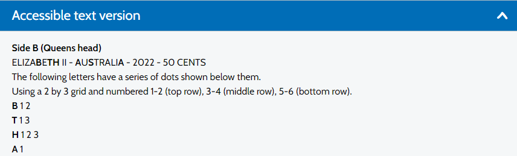
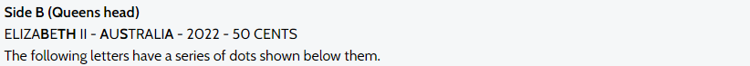
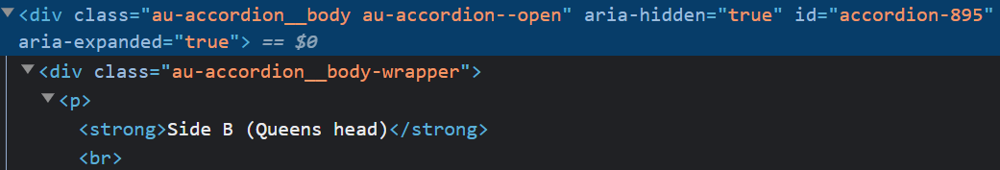
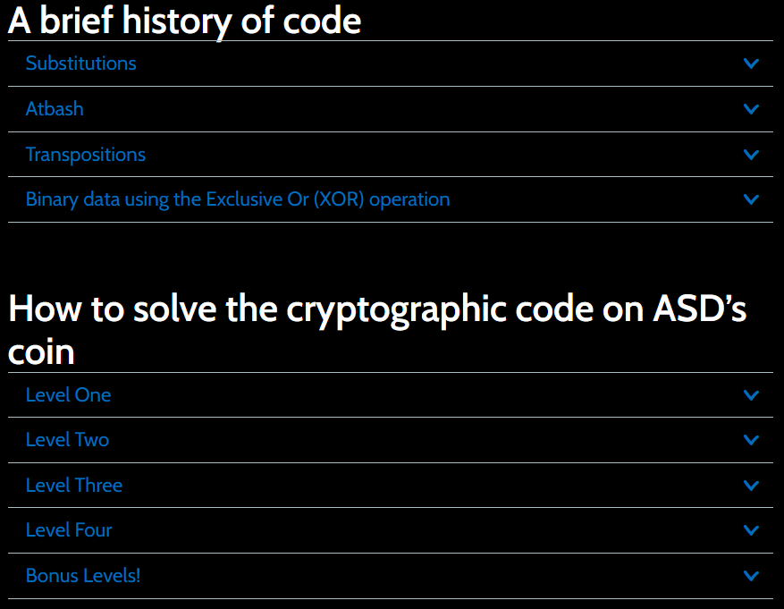
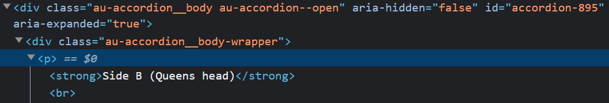

Describing complex images using just an `ALT` or `aria-label` attribute is difficult. When descriptions begin to move beyond a single sentence other alternatives are more appropriate. 

One of which is semantic HTML. This can be used to describe any differences visually as an alternative but less intrusive approach than screen reader text.

---

## Celebrating the 75th anniversary
In September 2022 the Australian Government's signal intercept agency [Australian Signals Directorate (ASD)](https://www.asd.gov.au/) celebrated its 75th birthday with the creation of a commemorative coin. [The announcement made via their website](https://www.asd.gov.au/75th-anniversary/events/2022-09-01-75th-anniversary-commemorative-coin), presented some unique opportunities to provide alternative text for people with disabilities.

**How to make a complex image multimodal and accessible to the widest possible audience using assistive technology?**

The coin image on the website used multiple layers of codes on both sides with a hidden message revealed after each layer was solved.

<div class="image image--border">
<figure>

<figcaption>The obverse and reverse of the Australian 50 cent coin.</figcaption>
</figure>
</div>

## An alternative to ALT text
For an information-rich image, relying on `ALT` text alone isn't particularly helpful. `ALT` text only describes the letters, yet cannot easily describe the different textures, emphasis, shapes, and arrangement which all feature prominently. 

The go-to approach when describing images for assistive technology users is an alternative text description via ALT attribute on the `` element. When encountered by assistive technology it then presents the description in another format. A screen reader user for example may hear the text description announced.

```html

```

Another equally valid approach is the `aria-label` attribute. 

```html

```

The general advice is to provide a succinct text description of what the image conveys and most times this approach works well.

The other piece of advice is to avoid literal descriptions. A literal description may describe what's contained in an image, but they don't describe the meaning of 
the image, _why is the image important?_ _what is its relevancy?_

But applying either technique (`ALT` text or `aria-label`) to an image with this level of detail becomes an exercise in hopelessness. Whilst the image of the coin could be described in text, the amount of additional text to include to describe the formatting, placement and emphasis would be immense.

```html
ALT="letters rotating around the edge of the coin, VKG are emphasised, the reverse of the coin is segmented into 3, with the letters E3B8287D4290F7233814D7A47A291DC0F71B2806D1A53B311CC4B97A0E1CC2B9…" 
```

You get the point. 

Using the `ALT` or `aria-label` attribute to provide a text alternative for this image is a lost cause. Taking this approach may be deemed "accessible" as alternative text has been provided but few can confidently say that it's in any way helpful or even useable. 

The descriptions of the formatting, placement and emphasis of the text get in the way of the text content. The user has to context switch and understand the text whilst trying to mentally construct the text arrangement all of which is described in text.

## ASD's approach
What ASD did was clever. Instead of providing an `ALT` or `aria-label` attribute, they used HTML elements to provide the context. They leveraged the semantics, HTML elements that describe meaning to content, allowing assistive technology to describe the visual difference.

The HTML elements `<strong>` and `<u>` were applied to describe the context without resorting to a text description. Depending on the assistive technology used when these elements are encountered it may output a difference in sound or provide an audible cue. The visual difference is explained without losing context for the user.

## Prompting the user
The first part of the alternative text description begins on the image, asking the user to **"See the accessible text version below for a detailed description of Side A (Non-Queens head) of the coin"**. 

```html

```

Although the wording for the description may be a little clumsily written, "see" provides a prompt to the user that further detail follows the image.

Immediately following is an accordion control with a clickable link for an accessible text version. This follows the [aria authoring accordion pattern](https://www.w3.org/WAI/ARIA/apg/patterns/accordion/) and uses dynamically changing aria attributes when the panel is activated. Triggering the screen reader to indicate content has expanded.

<div class="image image--border">
<figure>

<figcaption>The expanded content section showing Side B (Queens head) separating the coded sections of the coin with emphasis and spacing.</figcaption>
</figure>
</div>

Within the accordion control's expanded content the elements `<strong>` and `<u>` are used repeatedly to markup the visual emphasis in a way that doesn't diminish the content.

<div class="image image--border">
<figure>

<figcaption>A section of the side B (Queens head) content with the letters "B TH" of Elizabeth and "A S A" of Australia highlighted in bold.</figcaption>
</figure>
</div>

```html
<strong>Side B (Queens head)</strong>
<br>
ELIZA
<strong>B</strong>
E
<strong>TH</strong> 
II - 
<strong>A</strong>
U
<strong>S</strong>
TRALI
<strong>A</strong>
 - 2022 - 50 CENTS
<br>
The following letters have a series of dots shown below them.&nbsp;<br>
```

For the Side B (Queen's head) of the coin, the letters **"ELIZA E II U TRALI - 2022 - 50 CENTS"** use regular text with no semantic HTML applied whereas the letters **"B TH"** of Elizabeth and the letters **"A S A"** of **"Australia"** are individually contained in the element `<strong>`. 

Elsewhere on side A of the outer ring of the coin, the period character and letters **"Z L L Z M"** (amongst many others) are individually contained in the element `<u>`.

## Semantically describing the meaning
The `<strong>` and `<u>` elements are semantic HTML that describe the meaning of content. This is how individual characters with a visual difference should be marked up. These elements provide a structure that allows assistive technology to potentially be interpreted in a particular way different from regular text. 

Some assistive technology (depending on the tool) may use a difference in sound to convey the visual difference. Although screen readers JAWS and NVDA don't currently announce the difference, that isn't to say we should not use these elements as accessibility is more than just for people with a vision impairment. 

When semantic HTML is used there's a greater likelihood the output can be interpreted into a different mode which can help with user understanding. It may be reformatting it, using audible cues or an as-yet undecided option.

> As a segue at the 2023 Microsoft Ability Summit conference. Blind developer Roberto Perez in the presentation "Inclusive Development: Empower Every Developer and Their Teams to Achieve More" [describes intentional audio cues in Visual Studio](https://youtu.be/yNaXrk6i04c?list=PLtSVUgxIo6Krrx7urGpgbDgtvFVzgYnku&t=117) as being easier and faster to process than screen reader speech.

This future-proofs web content and allows it to become more flexible to the demands of assistive technology.

So far so good. ASD future-proofed the alternative text to allow assistive technology to use a different mode to highlight the visual difference described in the image. Whether the assistive technology implements the functionality is another matter.

## Great intention, poor implementation
But this is where the best of accessibility intentions suddenly takes a 180-degree turn and places the user back at the start of inaccessible content. 

**This article intended to show how Australia's spy agency created an accessible complex image. Detailing an incredible example of how feature-rich images could be provided in an alternative accessible format.** 

**But unfortunately, even the smartest people in the country have a challenging time implementing accessibility. This innovative approach using semantic HTML to describe a very complex image has an Achilles heel.**

Testing out the accessible text I repeatedly found the screen reader wouldn't output the accessible text at all, even though visually it was onscreen, structurally it was as if it was … _invisible_. And checking the HTML confirmed this. 

An `aria-hidden` attribute applied on the parent container of the accessible text had its value of true remain unchanged when the content expanded. Causing the child content to remain inaccessible for screen readers.

<div class="image image--border">
<figure>

<figcaption>The aria-hidden attribute remains unchanged when the accordion content is expanded.</figcaption>
</figure>
</div>

> This approach is acceptable when your motto is **"Reveal their secrets. Protect our own"** and you're hiding national secrets. But perhaps not so helpful when the accessible text version becomes invisible to screen reader users.

The expand and collapse content uses a familiar aria authored accordion component pattern built following the [aria authoring patterns](https://www.w3.org/WAI/ARIA/apg/patterns/accordion/). 

Because the control is not a native HTML element, aria attributes are applied to make the component announce its state (whether it is collapsed or expanded) to screen readers. 

Triggering each section should toggle the `aria-hidden` attribute from **true** to **false**, rendering the expanded content to be visible to a screen reader user. But the toggling of the attributes doesn't happen automatically, the behaviour needs to be coded correctly by a developer. 

Overlooking one stray `aria-hidden` value hides all child content from assistive technology.

And it isn't isolated either. The same issue repeats in the sections **"Substitutions"**, **"Atbash"**, **"Transpositions"** and **"Binary data using the Exclusive OR (XOR) operation"** and the entire **"How to solve the cryptographic code on ASD's coin"** section. 

All the content in these sections is hidden from screen reader users.

<div class="image image--border">
<figure>

<figcaption>The entire accordion control rendered hidden to a screen reader user.</figcaption>
</figure>
</div>

Fortunately, the fix is straightforward. When each accordion section is expanded ensure the corresponding `aria-hidden` attribute is toggled from **true** to **false**. Making the expanded child content viewable by a screen reader.

<div class="image image--border">
<figure>

<figcaption>The aria-hidden attribute toggled to "false" when the accordion content is expanded.</figcaption>
</figure>
</div>

## Summary
Aside from the unfortunate overlooked `aria-hidden` value not changing. ASD demonstrated a clever approach to leveraging semantic HTML to allow assistive technology to interpret content in a different way. 

It makes the content flexible to be reformatted in any number of possible ways by people using assistive technology. Complex descriptions in images can be described without always necessarily relying on a text description alone. 

Using semantic HTML elements can describe the difference easier than a text description. 

When the alternative text description for your complex images becomes itself complex, is there an alternative approach where the complexity can be described in another format?

### Things to consider
- Use semantic HTML to describe differences where a text description alone would become too complex.
- Semantic HTML may not always be interpreted by screen readers, but assistive technology may use those elements in other ways to describe meaning.
- Apply aria authoring patterns correctly and confirm all dynamic aria attributes change as appropriate.

## Resources
- [Australian Signals Directorate 75th Anniversary Commemorative Coin](https://www.asd.gov.au/75th-anniversary/events/2022-09-01-75th-anniversary-commemorative-coin)
- [Microsoft 2023 Ability Summit](https://www.youtube.com/playlist?list=PLtSVUgxIo6Krrx7urGpgbDgtvFVzgYnku) Inclusive Development: Empower Every Developer and Their Teams to Achieve More
- [em and strong are not announced by screen readers](https://www.stefanjudis.com/today-i-learned/em-and-strong-are-not-be-announced-by-screen-readers/)
- [Screen Readers lack emphasis](https://www.tpgi.com/screen-readers-lack-emphasis/) (2008)


