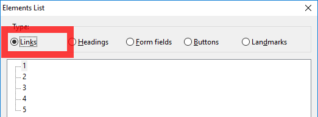
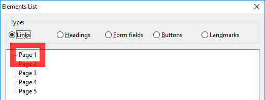
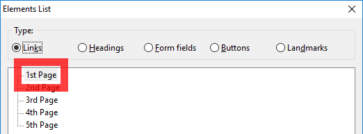

Pagination controls are the clickable numbered links found at the bottom of blocks of content which allows the user to load a next set of records. These are quite often one of the easier to identify accessibility failings for web content.

<figure>

<figcaption>The links list within NVDA</figcaption>
</figure>

The links list window within NVDA showing each link on the pagination control, as the links are viewed outside of the page they’re not understandable.

When the links are viewed out of context in the links list within JAWS and elements list in NVDA, if the links are numbered with no other identifying characteristics the user will not understand what each link does. Which will fail [WCAG 2.0 Guideline 2.4.4 Link Purpose (In Context)](https://www.w3.org/TR/UNDERSTANDING-WCAG20/navigation-mechanisms-refs.html).

A common solution is to add hidden text to each link, this will not display the text to the screen but when the link is viewed in the links list the hidden text will be shown and give greater meaning to the original link text.

If the links are numbered sequentially, you could add the word ‘page’ in front of the link text styled with a hidden CSS technique, and because we’ve given each link more context, the links would now be accessible?

<figure>

<figcaption>The first pagination link - page 1 - is highlighted</figcaption>
</figure>

After adding the word ‘page’ to each numbered link, the text is becoming more understandable

Not quite, the links list dialog in JAWS sorts links on a page alphabetically. If all the links begin with the word ‘page’ a user cannot easily navigate to Page 11 without first navigating and hearing the previous 10 links which all start with the word ‘page’, has it really been made accessible?

WebAIM suggest placing the [distinguishing information at the beginning of the link](https://webaim.org/techniques/hypertext/#link_to_link), instead of placing the word page at the front of the link followed by the number, place it after the number.

> Implication 2: Place the distinguishing information of links at the beginning of a link. Don't put extra information first, For example, don't say "Link opens in a new window: Products." Instead, say "Products (opens in a new window)" (or something along those lines)

This will ensure when the links are viewed out of context they are sorted correctly and the user can navigate the links easier.

1 Page, 2 Page … sounds kind of grammatically incorrect doesn’t it? This can be fixed by adding an ordinal indicator (st, nd, rd, th) after the numbers and using a CSS hidden display technique and a little JQuery.

<figure>

<figcaption>The first pagination link with the unique link text placed at the beginning</figcaption>
</figure>

Ensuring the unique link information is first (the number) adding an ordinal indicator and placing the repeating text ‘page’ last

Visually nothing has changed on the screen, however when viewed out of context the links are grammatically correct and accessible.
