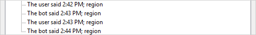
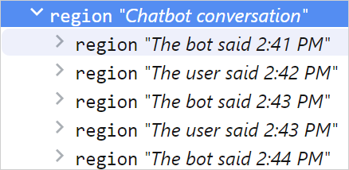
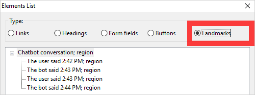

Using `DIV` and `SPAN` elements in your HTML isn't great. The generic elements are non-semantic, provide no meaning, and when they're overused mean you have to add extra meaning to the elements to provide structured information.

If you're putting time and effort into adding extra after-the-fact attributes and markup to make your `DIV` and `SPAN` elements provide more meaning, and thinking there's got to be a better way, well you're right, there is a better way and that’s with HTML5 elements.

## More meaning with HTML5
The HTML5 specification provides new elements, attributes and behaviours in your browser and combined with WCAG 2.0 techniques it gives you a lot more power to introduce more meaning into your web apps.

Browser adoption is very good so there is increasingly less reason to not use the elements, and HTML5 elements can help you avoid (or at least reduce) the `DIV`'itis of unclear code.

The elements can help a screen reader user understand more of the screen by providing context, and several of the elements can serve as waypoints to define regions or provide onscreen text in a way which makes onscreen functionality easier to understand.

## Browser support
The site HTML5 accessibility tests which features are supported by major browsers and if they're mapped to the accessibility API. An accessibility supported feature means its usable by people who rely on assistive technology.

Our chatbot UI fenton heavily used `DIV` and `SPAN` elements. They worked fine, but the code was overly reliant on these filler elements.

With the arrival of new elements in the HTML5 spec, it presented a great opportunity to update the HTML and make the chatbot UI more semantic and aid readability, besides who doesn’t like easier to read code?

## Conversation identity
Previously every message was created with a `DIV` element, with screen reader specific text contained in a `SPAN` identifying the source of the message.

```html
<div class="bot">
<span class="sr-hidden">The bot said </span>
Hi There!
</div>
```

There was nothing wrong with this approach and the technique worked, but the `DIV` provides no structural information and so lends itself to being replaced with a HTML5 `SECTION` element.

Placing each message within a `SECTION` provides greater meaning. It shows each message is related to the conversation and to each other, something which is difficult to do with ordinary DIV elements.

> The section element represents a generic section of a document or application. A section, in this context, is a thematic grouping of content, typically with a heading. [HTML
Living Standard](https://html.spec.whatwg.org/multipage/sections.html#the-section-element)

We also added to this an `aria-label` attribute to provide a unique name for the element and this is where we were creative. Every `SECTION` name needed to be unique, but if we used "the bot said" as a label multiple times it wouldn't be quite so unique, so we appended a timestamp to each message as well.

Every element has a unique name, and it assists the user traversing through the conversation history to understand the sequence of the messages when using a screen reader.

```html
<section aria-label="The bot said 2:41 PM" role="region">
Hi there!
</section>
```

The `role` attribute is for backwards compatibility for legacy browsers and is only a fall-back.

When tested in Chrome with NVDA, the landmark list displays several `SECTION` elements with the time they were displayed.

<div class="image image--border">
<figure>

<figcaption>The landmark list within NVDA displaying several regions each with a unique name</figcaption>
</figure>
</div>

The accessibility tree is how assistive technology makes sense of the webpage in a non-visual way. If the accessibility tree is showing a logical layout with appropriate element names there is greater likelihood of screen readers and other assisitive technologies interpreting the structure correctly.

<div class="image image--border">
<figure>

<figcaption>The accessibility tree within Chrome displaying nested region elements each with a unique name</figcaption>
</figure>
</div>

## Conversation container
The previous implementation used one `DIV` element for the conversation wrapper which contained all the conversations and this too was replaced with a `SECTION` element.

```html
<section id="conversation-body" tabindex="0" aria-label="Chatbot conversation">
<section class="bot" aria-label="The bot said 2:41 PM">
    Hello, I see you're looking at loans can I book you into see one of our lenders?</section>
<section class="user" aria-label="The user said 2:42 PM">
    That would be great, can I book in for Monday?
</section>
<section class="bot" aria-label="The bot said 2:43 PM">
    What's the closest branch to you?
</section>
<section class="user" aria-label="The user said 2:43 PM">
    I'm in Canberra, so it's the city branch
</section>
<section class="bot" aria-label="The bot said 2:44 PM">
    Great, I've booked you in to speak to one of our lenders on Monday</section>
</section>
```

The `SECTION` named 'conversation-body' contains several child `SECTION` elements representing the conversation history.

<div class="image image--border">
<figure>

<figcaption>The landmarks region within NVDA with unique sections nested within a container</figcaption>
</figure>
</div>

A screen reader user can identify the chatbot landmark and navigate to individual message landmarks within.

## Other features
Other features which we've previously written include the `TABINDEX` attribute to allow the conversation container to become keyboard focusable and scrollable using the arrow keys. The addition of `ARIA-LIVE=POLITE` which causes the audible announcement of new content through the screen reader, the value of 'polite' pauses announcement of the updates until all other screen reader announcements have finished.

```html
<section aria-label="Chatbot conversation" tabindex="0" aria-live="polite">

<section aria-label="The bot said 2:41 PM" role="region">
Hi there!
</section>

<section aria-label="You said 2:42 PM" role="region">
Hello, I'd like advice on a bank loan
</section>

</section>
```

Using HTML5 `SECTION` elements reduces the code to be written and increases its readability, the elements provide greater clarity around parts of the chatbot and help provide additional context for the end user.

## References
* Section elements [browser compatibility](https://developer.mozilla.org/en-US/docs/Web/HTML/Element/section#Browser_compatibility)
* Section elements [HTML5 accessibility support](https://thepaciellogroup.github.io/AT-browser-tests/test-files/section.html)
* Check out [Accessible chatbot design](https://www.canaxess.com.au/infocard/chatbots) for background information.