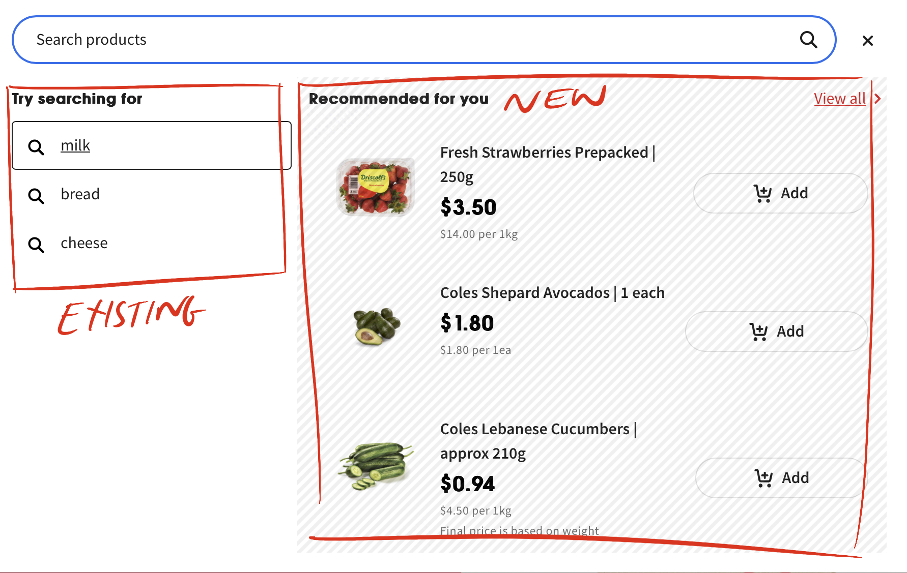
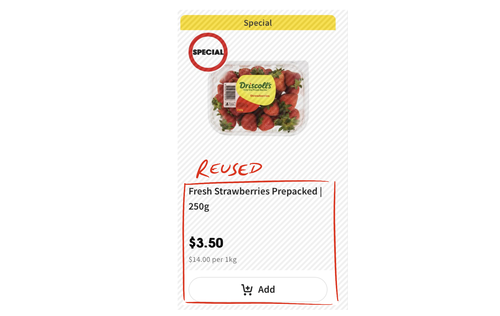
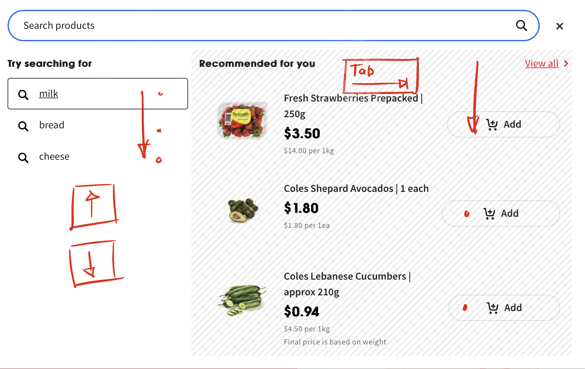

Supermarkets spend millions of dollars strategically placing products around the store to make it easier for you to purchase items and impulse buy – that extra bar of chocolate doesn’t make it into your trolley on its own without some gentle encouragement! 

Space that isn't used effectively is wasted and costs the company money and the online space is no different.

It's these constraints that accessibility and business objectives become uneasy friends. Where compromises are made to support users and help the business do what it's good at.

And it's these challenges we found working with Coles.

## Reusing existing features

The team had a request for the established product search feature on <a href="http://www.coles.com.au">coles.com.au</a> to include items that a customer had bought previously. 

When a customer is searching for items, they're reminded of previous purchases. Whilst a win for the customer and business, the approach had significant challenges for accessibility and the user experience. 

<figure>

<figcaption>The existing suggested results combined with the previous purchases component within the search component</figcaption>
</figure>

The existing search feature was navigable using the arrow keys. <a href="https://www.coles.com.au/search?q=milk">A search for "milk"</a> yielded several suggestions each rendered in a DIV element. Pressing the up and down arrow keys and pressing Enter selects the product in focus and triggers a search. 

Whilst the bought previously feature reused a component from the product listing page. This component was built using native HTML headings and link elements. 

<figure>

<figcaption>The reused product listing component</figcaption>
</figure>

Where each product tile is navigable via the Tab key. Using native HTML meant the keyboard focus sequence was how the items were displayed, allowing users to navigate from top to bottom using familiar key presses on the Tab key. 

## Two different yet valid navigation approaches
Combining these two separate components into one new composite component sounded straightforward. Both had been created with accessibility in mind, both traversable via the keyboard and both supported keyboard interactions.

But this is the problem. The way a user navigates through the two components is fundamentally different. The arrow keys navigate the list for the search results, yet for the product tiles, it's the Tab key. 

These are two different yet equally valid ways of navigating for products in two different scenarios. Yet when combined these two ways become opposites, an uneasy mix of two navigation patterns.

**So, what to do?**

## Introducing a new navigation pattern?
We discussed changing the way the user navigates in each component. Could the arrow key navigation in the search results be replaced with the Tab key to better align with the navigation on the product tiles? 

It could, but the search results aren't links. They're clickable DIV elements and items to be selected so it feels like the enter key is the right keyboard interaction to maintain. 

Besides all users with an established mental model familiar with navigating via arrow keys would be forced to relearn how to navigate. Clearly, that's not a great user experience.

Equally forcing all users to navigate native HTML product tiles (already navigable with the Tab key) via the arrow keys is also a poor user experience. 

Sure, the navigation and user experience would be harmonised on the composite search component, but the user experience is impacted. 

It's been made worse for everyone all for the sake of trying to establish a consistent keyboard navigation pattern. 

Each approach had a small benefit and an incredibly large detrimental effect. Each approach would deliver a poor user experience for the keyboard user.

## No good outcome
Collectively the team recognised neither approach would work. Instead of forcing a new keyboard navigation pattern onto the user, maintaining the existing keyboard navigation behaviour in each component was the best approach. 

The two elements when combined retained the arrow key navigation for the search results and Tab key navigation for the previously bought items.

<figure>

<figcaption>The composite component retaining existing keyboard navigation behaviour</figcaption>
</figure>

There is no overlap between the two navigation methods. The arrow keys do not move focus to the previously bought products, the Tab key does not move focus to the search results items. It's the digital equivalent of chalk and cheese. 

Two unrelated components are forced together but still operate independently.

## Picking at the digital thread
It's not the outcome hoped for. But this is how accessibility often is. The best approach can become a compromise. A tug-of-war battle between business objectives and improving the user's experience.

It's tempting to try and find a better solution. a neater approach that establishes a consistent way a user navigates across multiple screens and features, but this becomes scope creep. The unwanted picking at a loose digital thread. 

In this instance, the best outcome was to keep the components operating independently. Either approach would have forced the user into re-learning navigation patterns, and with online supermarkets, reducing the friction for the end user is the goal.