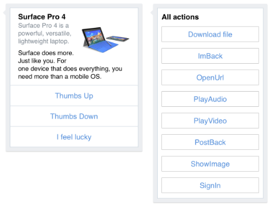

Chatbots can be a really great way to solve a variety of business needs. Users can have any of their questions answered or can be guided to finding information they need. However, coding chatbots correctly to ensure they’re easy to use with assistive technology, or via the keyboard, can be a real challenge.

The hard work creating an accessible website can be quickly impacted by using a chatbot with poor accessibility and in the worst case no accessibility. By learning the concepts in this post, you’ll become equipped to design a bot that aligns with best practice accessibility support and ensures you’re reaching all users regardless of their individual challenges.

## Choose the best platform
Many vendors now offer chatbots, and each have varying levels of customisation. When choosing, look for a product which allows a custom user interface to be created with HTML and CSS. Having full control over any frontend code will mean you’re able to deliver the greatest level of accessibility support.

## Provide skip links
The accepted location of chatbots tends to favour the lower right of the screen, and this presents difficulties for keyboard users. If there are many links on the page, the bot may only be reachable after tabbing through many in-between links first. These in between links can be avoided by allowing a user to navigate straight to the chatbot when a skip link is provided at the top of the page,

The skip link is an in-page anchor which uses the ID of the HTML element containing the bot. When the link is clicked, screen focus is moved to the bot’s container.

```html
<a href="#chatbot">Skip to Chatbot</a>
```

## Ability to read the transcript
Being able to read all the previous messages in the conversation is crucial for a user to understand what has been said and by whom. However, ordinary DIV elements (what we use to display each conversation) are not available in the keyboard tab sequence. We can overcome this by adding the tabindex attribute onto each text conversation block allowing a user to tab through the conversation history.

```html
<div tabindex="0">
```

## Identifying who said what
The aria-label attribute on each conversation block provides a convenient way to identify who has said which part of the conversation, was it the bot or the user. The aria-label attribute allows the text to be announced through the assistive technology. It’s helpful to understand that the aria-label text will only be announced when the user is tabbing through the conversation history.

```html
<div tabindex="0" aria-label="The bot said">
How likely are you to recommend this service?
</div>
```

## Handling dynamic content
Updating and changing content must have an aria attribute added to allow dynamic changes to be announced audibly by assistive technology. Each conversation block should be a contained within one parent container, and that container has the aria-live attribute with the value polite.

```html
<div id="text_body" aria-live="polite">
Reply from the bot/user
</div> $('#text_body').append(~user/bot reply~);
```

Whenever the conversation display updates, the assistive technology will only announce the new content. By using it in this way, only the most recent response is announced, not the whole conversation. And importantly, the polite value will only announce content when the user is idle, to not to become a distraction, or override other more important screen reader notifications.

## Rich media replies
Many bot platforms can send a variety of message formats, not just text. Although text content is the most straight-forward to make accessible, there may be business needs which require richer visual replies and this non-text content is an added challenge to make accessible.

> As the complexity of the bot’s communications increases to include more than just text, so too does the effort required to make the replies accessible.

<div class="image image--border">
<figure>

<figcaption>An example of a richmedia card from the Microsoft Azure chatbot</figcaption>
</figure>
</div>

We’ve been testing the Microsoft bot framework which allows a bot to reply in ‘cards’ which can have rich media including images and buttons to allow the user to interact in ways other than typing. Our testing on this platform has identified approaches which will make these activity cards accessible, but it requires significant front-end parsing of the bot’s communication with Javascript.

Be aware of quick accessibility fixes. **As the complexity of the bot’s communications increases to include more than just text, so too does the effort required to make the replies accessible.**

## Other factors which influence bot accessibility
* Is a relative font size used to allow onscreen text to resize?
* Is a sufficient colour contrast in use to make it easier to identify replies?
* Is the bot being displayed the best way when viewed on other devices?
* Is the bot’s language tailored to the audience?

None of these questions directly relate to factors which make the bot inaccessible, but they are extra techniques which when considered will make the user experience better. A great bot experience has extra support in place which provides a seamless experience regardless of any users’ challenges.

**The process of designing an accessible bot is the same as designing an accessible web app or website. Use correct semantic HTML to provide a solid skeleton of accessibility support and choose platforms and products which allow greater customisation.**

Whenever you are unsure that your providing accessibility support try using the bot just with the keyboard, if you’re able to still control the bot with no mouse input then you’re designing it right.