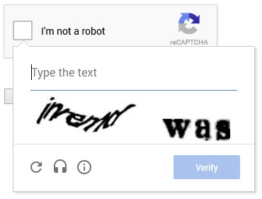
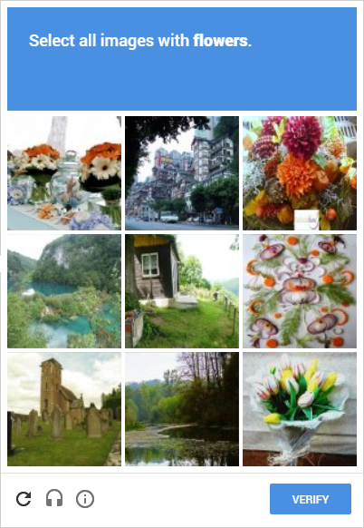

Captcha is the most effective way to stop spammers. However, captcha isn’t accessible and presents real challenges for people with disabilities. There are better approaches which offer similar levels of security and are more accessible and should be considered.

Captcha is a security feature found on websites to stop automated signups from spambots. A user is asked to type a collection of characters or numbers which are distorted to prove they are a real user wanting to sign up.

The problem with using captcha is that it isn’t accessible. The distorted text is very hard to see and the audio option is itself distorted. This makes it difficult to understand and this is usually combined with a user interface which has very poor keyboard support.

From a user experience perspective, why should users have to prove they’re human?

## The challenge with Google reCaptcha and why you should avoid it

<figure>

<figcaption>Google's familiar type the letters captcha</figcaption>
</figure>

Google have made huge improvements with their recaptcha mechanism. A simple checkbox asks the user if they are human and when ticked allows the form to be submitted. This checkbox is announced by screen readers and shows up in the keyboard tab sequence.

Unfortunately, if Google’s recaptcha mechanism determines the user’s behaviour is unusual the accessible captcha reverts to the old style of requesting the user to identify images, or sketch an outline.

<figure>

<figcaption>Google's invisible recaptcha challenge</figcaption>
</figure>

It is not accessible. The vision impaired user cannot see the image they’re asked to interact with and the keyboard user cannot sketch around the image (if one is displayed).

Worse still, the audio alternative offered is not keyboard accessible and does not appear in the keyboard tab sequence.

## How the strategy of layered security can help you
Fortunately, there are other techniques which can offer similar levels of security to stop bots abusing your systems and creating fraudulent accounts.

A technique which can be used is that of layered security – “defence in depth”. Layered security is a strategy of not relying upon one method to stop spammers but using a combination. If one of the layers is breached there are still others stopping the fraudulent activity.

**Consider using all the following techniques.**

## 1. Use a honeypot
One of the most popular methods is a honeypot. Spambots trawl forms and fill all the available fields with data and submit it automatically. We can use a form field hidden with CSS to render it invisible to the screen.

When the form is submitted, if this hidden form field is not blank consider that the form has been compromised by a bot and discard the forms input.

## Think carefully how you implement it
The way the honeypot technique is implemented can alter its effectiveness. Use CSS to hide the form field, don’t use input controls of type hidden. Use a name for the hidden form field that is commonly found on contact or signup forms.

Consider the name “fax” for the hidden form field, it’s unlikely a fax number is used. Avoid the use of field names such as “honeypot” or similar as this can be easily ignored by the bots. You don’t want to inadvertently make it easy for the bots to ignore the honeypot.

Make sure to use the autocomplete attribute and set this to “off” to stop the browser prepopulating the field.

User Nick J on stackoverflow explains the [technical details of a better honeypot implementation](https://stackoverflow.com/questions/36227376/better-honeypot-implementation-form-anti-spam#answer-36227377).

## 2. Form submission time
Calculate the time taken to submit the form. If the time was very short, for example, less than 5 seconds assume the form has been compromised and discard it.

User zaba on the interactivetools forum explains the [technical detail with a PHP implementation](https://www.interactivetools.com/forum/forum-posts.php?postNum=2229400#post2229331).

## 3. Email verification
Send the user an email asking them to confirm their email address by clicking a time limited link. By requesting the user click a link in their email we assume the user is human, this approach works very well with an account creation process.

## The techniques you should avoid
Other techniques of providing mathematical questions or relying on the user to type in words or phrases should be approached cautiously.

Both examples could be difficult to solve if the user has a cognitive impairment affecting their ability to solve equations, or if English is a second language.

## More inclusive but a compromise has been made
These techniques aren’t foolproof. Given enough time and effort the techniques will be overcome (as will most captchas). The aim is to slow down the spambots enough that repeated attempts to signup become unsustainable for the spammers and they move to easier targets.

Test the effectiveness over a couple of months and if the approach is being overcome begin to tweak the layers.

## In Summary
Current captchas aren’t accessible and present significant challenges for people with disabilities. Images can’t be adequately described, mouse only for some modes of operation and distorted audio all mean captcha shouldn’t even be considered.

**The honeypot technique is a worthy replacement but it needs to be combined with other security techniques to be effective.**

**It needs continual monitoring and adjustment to remain effective. If you care about your users experience, replacing captcha with the layered security technique offers significant advantages.**