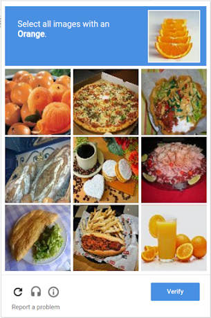
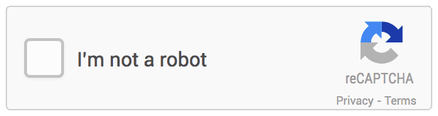
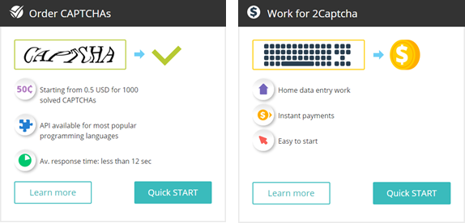
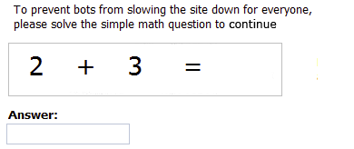
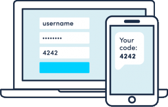
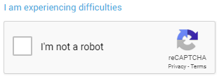

I've spoken previously how using CAPTCHA is a really bad way of securing your website because it's inaccessible, but for people who don’t work in web accessibility it's difficult to appreciate the problems that makes it inaccessible when you begin using it on a website.

## Recap: What is CAPTCHA?
CAPTCHA are the challenges you often see on websites and online services. Users are asked to prove they're human by solving visual puzzles, identifying a collection of images or letters and numbers which are obscured by lines are other distortions.

<figure>

<figcaption>Googles' ReCaptcha asking the user to select all images with an oranges</figcaption>
</figure>

## Why use it?
It’s a way to prevent bad people using automated tools to break into your website to create fake accounts, spam users and generally become an annoyance.

The theory is humans excel at the task of correctly identifying distorted text unlike computers.

By having a mechanism is place which is only solvable by people, it reduces the likelihood of your online service being compromised.

Many of the popular captchas are free to use, fully automated and are straight forward to get up and running.

## How CAPTCHA works
Before a user can perform an action or complete a task a CAPTCHA challenge is presented. When the challenge is completed successfully (for example choosing every image that is a street sign) the user is confirmed as being human and they’re allowed to continue performing their task.

## CAPTCHA aren’t accessible
The problem is that CAPTCHA aren’t accessible. It can be difficult to use via the keyboard and impossible to use if you're vision impaired.

The audio is hard to listen to – and understand it, as its often combined with a lot of static or extra noise and in the case of comparing images, users with cognitive impairments can have extreme difficulties.

Even users without impairments can have difficulty trying to decipher the cryptic text. **Google acknowledge their reCaptcha text is so complicated that even humans only solve it 87% of the time.**

There are alternatives to inaccessible and difficult CAPTCHA. One is Google's invisible reCaptcha, promising users just need to tick a box to indicate they're not a robot.

<figure>

<figcaption>The new CAPTCHA where the user only needs to confirm they're not a robot</figcaption>
</figure>

It uses a range of criteria to determine whether an action is being submitted by a human. This can include watching's the user's behaviour on the page – do they linger, do they scroll the page. Does the user have a Google account, and advanced risk analysis such as where in the world the user is originating.

## So, problem solved?
Unfortunately, no the problem isn’t solved. Whilst all the promise sounds great ensuring a user would never see a CAPTCHA challenge because of some sophisticated backend technology. On the Google website is this statement:

> Sometimes we need some extra info from you to make sure you’re human and not a robot, so we ask you to solve a challenge

## How confident are you using it?
If you're unable to say for certain that users will never see a CAPTCHA displayed, which has significant accessibility challenges, is it wise to continue using it?

We all put a lot of time and effort into making the online services we create accessible, if you're in Government both the UK and Australian governments have statements describing government websites must be accessible up to Web Content Accessibility Guidelines (WCAG) 2.0 AA.

All online services must be accessible, but all begins to be undermined when we secure the service with a CAPTCHA.

## CAPTCHA has also been compromised
CAPTCHA solving is being outsourced by spammers in low cost countries where they use real people to churn through large numbers of distorted text for a fraction of a cent.

<figure>

<figcaption>Bot farm advertising detailing the cost</figcaption>
</figure>

Prices are very low from 50c per 1000 CAPTCHA and API’s exist which allow the service to be used easily in many modern development environments. It doesn’t take much effort to get up and running, and it's incredibly cheap.

## Background reading
Australian security researcher Troy Hunt has a great bit of background reading about [breaking CAPTCHA](https://www.troyhunt.com/breaking-captcha-with-automated-humans/).

> Only humans can break the code and complete these signup processes, right? But what if we could automate the humans; I mean what if we could take CAPTCHAs and solve them at such a rate that these registration processes could be easily automated? Well it turns out you can and it will only cost you a couple of bucks.

And recently a Californian artificial intelligence company funded by Amazon and Facebook cofounders have developed AI that can outsmart Captcha. In 2013 it announced it had cracked text based captchas used by Google, Yahoo and PayPal with a 90% accuracy.

> We're not seeing attacks on Captcha at the moment, but within three or four months, whatever the researchers have developed will become mainstream, so Captcha's days are numbered,

Since then it's able to pass Googles reCaptchas 66.6% of the time. The creators say the very nature of big data analysis and machine learning is that if you give it enough data to play with it will eventually work out most things.

## Other alternatives
There are a several alternatives that should be considered:

* We can check the time taken to submit a form, if the form is submitted in a very short length of time we can consider the form to have been submitted by a bot and ignore the input.

* We can use the [honeypot principle](https://stackoverflow.com/questions/36227376/better-honeypot-implementation-form-anti-spam) to tempt bots to identify themselves by filling in a hidden form field. A form field is hidden with CSS, as people can't see it, this always remains empty. If this is filled when the form is submitted, we assume it's been submitted by a bot and ignore its input.

* And we can ask a user to click a link from an email they've received to confirm they're a real user and not a bot.

## Defence in depth
All of these are reasonable steps, but we can go further and adopt the principle of layered security or defence in depth. A strategy combining several approaches, if one approach is compromised there are several other techniques to rely on.

The more security measures which are in place can mean the more difficult it will be for bots to get though.

## Number CAPTCHA problem
Other techniques for CAPTCHA alternatives often recommend the adding together of two numbers.

<figure>

<figcaption>Simple mathematical question asking the user to add two simple numbers together</figcaption>
</figure>

However, bots are cleverly written already, if they're able to interact with a page and submit a form then I don’t believe working out simple mathematics poses much of a problem.

## Word CAPTCHA problem
Another method is a question and answer where a user is asked a question and they have to provide the correct answer.

Unfortunately, you'd have to have 100's of question and answer combinations to ensure the questions don’t repeat, it's limited to an English-speaking audience and if users have English as a second language the question may not be easily understood.

## Not a good look
Besides the perception of providing a question and answer on a government website or large organisation isn’t great and it can undermine the confidence of the person using the site.

## The problem
CAPTCHA is a frontend solution to a backend problem, it’s a programmer's way to ensure an online system is protected and it generally works. It's been attacked and compromised in limited ways, but it currently is an effective way to secure your system.

Although as I discussed earlier with CAPTCHA farms and AI it can only be a matter of time before CAPTCHA is being broken 100% of the time.

Although CAPTCHA is pretty effective currently, that effectiveness comes with a significant disadvantage and that's stopping users who use a screen reader or other assistive technology from using your website.

It’s a poor user experience and the user shouldn’t be burdened with having to prove they're human.

## Most viable alternatives
Some of the most viable alternatives as I see it:

* SMS text message
* Asking the user to self-declare on any signup screen
* Staff assistance if the user is having problems
* Robust application monitoring

## SMS text message
Whenever a user is performing a critical task such as creating an account, or posting to a forum, text a code to their phone. Two factor authentication has worked for banks, it's in use with the Australian Government with MyGov, and both Hotmail and Google use it extensively.

<figure>

<figcaption>Two factor authentication with a code sent by SMS to the phone</figcaption>
</figure>

However, it can incur significant costs if all users have been moved to receiving a text message, so perhaps be discerning and only offer that method to users who would benefit the most.

## Self declaration
We could identify users who require greater support via asking them to self-declare, if they do don’t show CAPTCHA and instead provide the text message option.

<figure>

<figcaption>Asking the user to self declare their disability</figcaption>
</figure>

However not everyone is willing to self-declare and rightly so to, it feels discriminatory and why should a user have to indicate they're different and require special treatment?

## Staff assistance
Provide a method for a user to contact a real support person who can guide them through any signup process and avoid having to use CAPTCHA.

Provide a link before the start of the CAPTCHA for users to contact you if they're experiencing problems solving the challenge.

<figure>

<figcaption>"I am experiencing difficulties" link above the regular CAPTCHA</figcaption>
</figure>

Providing an alternate way to validate a user

It's not great but it can be a stop gap approach whilst a long-term strategy is identified for transitioning from CAPTCHA to a more suitable method.

## Application monitoring
Consider application monitoring as well, if you notice an unusual number of accounts being created or many requests coming from the same IP address, investigate and if necessary block.

## The trade off
Security and accessibility can co-exist together, except when CAPTCHA is used. **If you use CAPTCHA to secure your website, it will decrease the accessibility of it.**

## Summary
Current CAPTCHA implementations are not accessible and have been broken. They cannot be relied upon to secure online government and large organisation online services when those services need to be available for all users regardless of impairments.

Vendors often say their CAPTCHA is accessible, but unless it's thoroughly tested by accessibility testing staff, and users with impairments and everyone agrees that it presents no challenges, don’t trust the vendor claims.

Parts may be accessible but it’s not good enough the whole component needs to be accessible. Your users, our users, deserve a better experience than what they currently have with CAPTCHA.

## Put users first
The Australian Government's [Digital Service Standard](https://www.dta.gov.au/standard/) advocates putting the user first, what user need is there for using CAPTCHA?

It’s a business need, and not a user need.
Push back against the security requirement which says CAPTCHA must be used, there are other security techniques which are more inclusive and have similar if not identical levels of protection.

**If you use CAPTCHA it will make your online service inaccessible.**